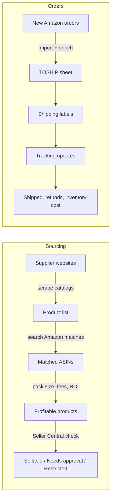

# Amazon Arbitrage Automation Toolkit

Python and Selenium tools that automate an Amazon seller's daily work. They find profitable products, check whether the seller is allowed to list them, and take each order from sale to delivery. Google Sheets serves as the shared dashboard.

I built this as freelance work for Amazon sellers (2023–2025). It is about 5,000 lines of Python across 40 scripts.

---

## The problem

An online-arbitrage seller buys products from retail and wholesale websites and resells them on Amazon. By hand, that means:

- browsing supplier catalogs and copying products one by one
- finding the same item on Amazon and working out fees, pack sizes and profit
- checking whether the seller account is allowed to sell each item
- copying every new order into a spreadsheet, then buying the item, making a shipping label and tracking delivery

That adds up to hours of copy-and-paste every day. This toolkit automates most of it.

## How it works



### 1. Product sourcing

- **Supplier scraping:** collects product name, price, link, variation and pack size from 12 supplier websites (for example Walmart, WebstaurantStore and Bulk Office Supply), including multi-page categories.
- **Amazon matching:** searches for each supplier product and pulls out the matching Amazon ASIN, title and price.
- **Pack size and variation parsing:** a regex engine (`Reg.py`) reads titles such as "Pack of 12", "24 ct" or "3-Pack", plus size and color variations, so a single unit is never compared with a 12-pack.
- **Profit and ROI calculation:** converts the Buy Box price to a per-unit price, subtracts the FBA fee, the referral fee and the supplier cost, then reports profit and ROI for each product.
- **Competitor storefront research:** collects the product lists of selected competitor storefronts on Amazon.
- **Selling-eligibility check:** checks each ASIN in Seller Central for listing restrictions, requests approval automatically where Amazon allows it, and sorts products into *ready to sell*, *approval requested* and *not eligible* sheets.

### 2. Order operations

- **Order import:** reads unshipped orders from Seller Central across every results page, skips duplicates and adds new orders to the `TOSHIP` sheet.
- **Order enrichment:** opens each order and fills in shipping details, ship-by and deliver-by dates, the matched supplier link, cost, fees, profit and ROI. It also looks up stock across several inventory sheets.
- **Shipping labels:** turns orders marked for labeling into a bulk label sheet with sender, recipient, package size, weight and pack count.
- **Tracking:** checks USPS tracking status and updates each order's row.
- **Shipped orders and refunds:** syncs shipped orders and records any refunds found on the order pages.
- **Inventory costing (FIFO):** calculates the cost of goods sold first-in, first-out across purchase batches and keeps the in-stock inventory current. It supports two business partners who share stock: when one partner ships units that the other bought, the borrowed units are costed separately for each partner.

## Built to run unattended

These scripts run for hours, often overnight, so they are designed to recover on their own:

- **Survives internet drops:** waits and retries instead of crashing (`SharedFunc.py`).
- **Handles dynamic pages:** uses Selenium explicit waits, and selects Seller Central dropdowns that are rendered in shadow DOM with JavaScript. It opens and closes the extra browser tabs that some actions create.
- **Stays inside Google Sheets API limits:** writes rows in batches of 10–50 instead of one call per cell.
- **Safe to re-run:** duplicate checks ensure the same order is never added twice.
- **Polite request rate:** waits a random interval between searches, and pauses so a person can respond if a CAPTCHA appears.
- **No stored passwords:** scripts open Chrome and wait for you to sign in to Seller Central yourself, including the one-time code. No Amazon login details are kept in the code.

## Results

> Replace these with your real numbers before publishing.

- Saves about **[X] hours per week** of manual work
- Processes **[X] orders per day** from import to label
- Screens **[X] supplier products per run** for profitable matches

## Tech stack

**Python 3.13** · **Selenium** (Chrome) · **BeautifulSoup** · **gspread** / Google Sheets API · Google service accounts · regex · requests

## Project structure

| Stage | Scripts |
|---|---|
| Supplier scraping | `WalmartGet.py`, `Webstaurant.py`, `Products.py`, `Bulkoffice.py`, `KTSupplyW.py`, `YamiGet.py`, `vipbarber.py`, `regowholesale.py`, `pricemaster.py`, `ThriftyWhite.py`, `Youngsga.py`, `EEdistribution.py`, `OTCWebGet.py` |
| Amazon matching | `ReverseSel.py`, `ReverseSoup.py`, `GoogleAmz.py`, `SelSearch.py`, `SoupSearch.py`, `SoupSearch2.py`, `ExtractSel.py`, `ExtractSoup.py`, `AsinExtractFromAmazonLink.py` |
| Parsing and pricing | `Reg.py`, `pack.py`, `PriceTarget.py`, `NoRes.py` |
| Competitor research | `SellersProducts.py` |
| Selling eligibility | `SellerCentralAdd.py`, `SellerCentralAddExtra.py`, `AddSeller.py` |
| Orders | `ToShip.py`, `Extractcount.py`, `Shipped.py`, `Refunds.py` |
| Shipping and tracking | `labels.py`, `Tracking.py`, `TrackingUSPS.py` |
| Inventory | `Inventory.py`, `InventoryConcepts.py` |
| Shared helpers | `SharedFunc.py` |

## Setup

**1. Install the requirements**

You need Python 3.10 or newer and Google Chrome.

```bash
pip install -r requirements.txt
```

**2. Connect Google Sheets**

1. In Google Cloud, create a service account and download its JSON key.
2. Save the key in the project folder as `credentials1.json`. It is listed in `.gitignore`, so it is never committed.
3. Share your Google Sheet with the service account's email address and give it Editor access.

**3. Fill in your own settings**

Each script has a config section near the top. Replace the placeholders with your own values:

| Placeholder | What it is |
|---|---|
| `YOUR_SOURCING_SHEET_ID` | Product research sheet (tabs `sheet1`–`sheet4`) |
| `YOUR_ORDERS_SHEET_ID` | Order sheet (tabs `TOSHIP`, `SHIPPED`) |
| `YOUR_PARTNER_A_ORDERS_SHEET_ID`, `YOUR_PARTNER_B_ORDERS_SHEET_ID` | Each partner's order sheet, used for inventory and refunds |
| `YOUR_INVENTORY_SHEET_ID` | Purchases and in-stock inventory |
| `YOUR_LABELS_SHEET_ID` | Output sheet for bulk shipping labels |
| `sender_info` in `labels.py` | Your return address for labels |
| `SELLER_URLS` in `SellersProducts.py` | Storefront links of sellers to research |

A sheet ID is the long code in the sheet's link: `docs.google.com/spreadsheets/d/<SHEET_ID>/edit`.

**4. Run a script**

```bash
python ToShip.py
```

Scripts that use Seller Central open Chrome and wait for you to sign in, then continue on their own.

## Notes

This project was built for real seller operations. Automated access may be limited by the terms of the websites involved, so use it responsibly.

## Author

**Qaisar Khan**
[GitHub](https://github.com/QaisarKhan36) · [LinkedIn](https://www.linkedin.com/in/qaisar-khan-dev)
